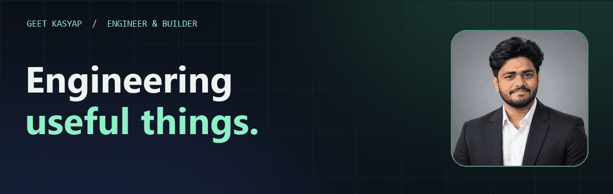
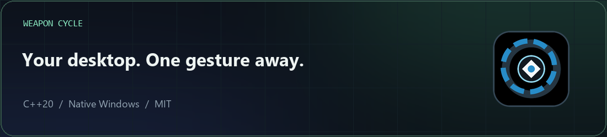
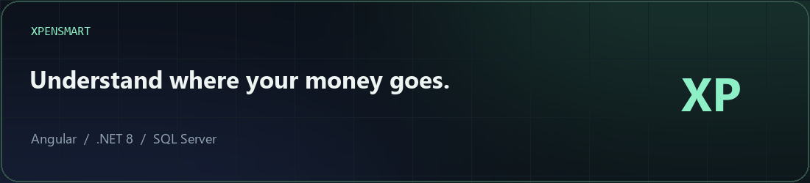

<!-- ======================================================================
  PORTFOLIO LINK: search this file for "geetkasyap.com" and replace every
  https://geetkasyap.com with your real portfolio URL when it is live.
  (The typing animation line and the Portfolio badge both use it.)
======================================================================= -->

<p align="center">
  
</p>

<p align="center">
  <a href="https://github.com/geetkasyap">
    
  </a>
</p>

<p align="center">
  <a href="https://www.linkedin.com/in/geet-kasyap"></a>
  <a href="mailto:geetkasyap291@gmail.com"></a>
  <!-- PORTFOLIO: replace https://geetkasyap.com below with your real URL -->
  <a href="https://geetkasyap.com"></a>
  
</p>


## 🧑‍💻 About me


I'm a **Machine Learning Developer** in Bengaluru, India 🇮🇳, working where **applied AI meets solid software engineering**.

- 🤖 Building **agentic AI**: multi-agent RAG, LangGraph workflows, vector search and LLM evaluation
- 🏗️ Shipping **.NET 8 microservices + Angular** for enterprise healthcare and portfolio platforms
- 🧭 Led a **20-member delivery team** as technical lead on a microservices platform
- 🏆 **Top 5** in an international AI hackathon · 🇮🇳 **DPIIT recognition** for a real-time cyber-safety app
- 🎤 Speaker at internal **AI Guild** sessions on agentic architecture and document intelligence
- ⚡ After hours I build **useful desktop tools**, like **[Weapon Cycle](https://github.com/geetkasyap/WeaponCycle)**

```python
class GeetKasyap:
    role      = "Machine Learning Developer and .Net Full Stack Developer"
    based_in  = "Bengaluru, India"
    ai        = ["LangChain", "LangGraph", "RAG", "OpenAI", "pgvector", "ChromaDB"]
    backend   = ["C#", ".NET 8", "Python", "FastAPI", "SQL"]
    frontend  = ["Angular", "React", "TypeScript"]
    cloud     = ["Azure", "AWS", "Docker"]
    motto     = "Useful software. Thoughtful interfaces. Less friction."
```

<br clear="right">

## 🚀 Featured projects

<a href="https://github.com/geetkasyap/WeaponCycle"></a>

> **⚡ [Weapon Cycle](https://github.com/geetkasyap/WeaponCycle)**: hold `Shift+Space`, point, release. A free, open-source radial launcher for Windows. **One portable 1.2 MB exe, no installer, no admin rights**, so it runs on home PCs and office laptops alike. [▶ Watch the demo](https://github.com/geetkasyap/WeaponCycle/blob/main/docs/media/brag.mp4)

<a href="https://github.com/geetkasyap/Xpensmart"></a>

> **💸 [Xpensmart](https://github.com/geetkasyap/Xpensmart)**: a full-stack expense manager with budgets, recurring payments, shared accounts, split expenses and rich reports. Angular · ASP.NET Core · SQL Server.

## 🛠️ Tech stack

<p align="center">
  <br>
  <br>
  <br>
  
</p>

<p align="center">
  
  
  
  
  
  
  
  
  
</p>

## 🏅 Certifications

<p align="center">
  
  
  
</p>

## 📈 GitHub activity

<p align="center">
  
</p>

<p align="center">
  <picture>
    <source media="(prefers-color-scheme: dark)" srcset="https://raw.githubusercontent.com/geetkasyap/geetkasyap/output/github-snake-dark.svg">
    <source media="(prefers-color-scheme: light)" srcset="https://raw.githubusercontent.com/geetkasyap/geetkasyap/output/github-snake.svg">
    
  </picture>
</p>

## 🤝 Let's connect

<p align="center">
  Open to conversations about <b>applied AI</b>, <b>agentic systems</b>, <b>.NET / Angular platforms</b> and <b>developer tools</b>.<br>
  <a href="https://www.linkedin.com/in/geet-kasyap">LinkedIn</a> · <a href="mailto:geetkasyap291@gmail.com">Email</a> · <a href="https://geetkasyap.com">Portfolio</a>
</p>


